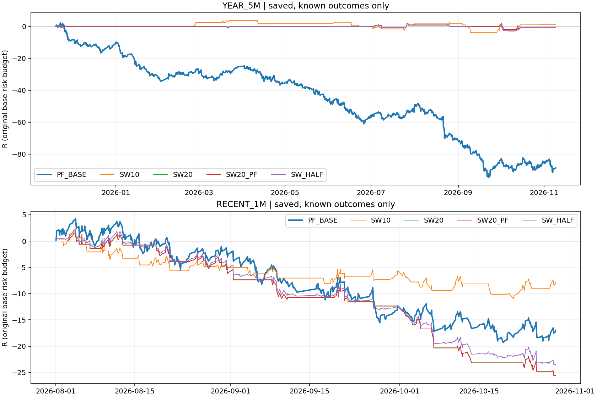

# PF: переключение по своей кривой

Готовые исходы, без нового replay. Кандидатов: 0. YEAR_5M и RECENT_1M не смешиваются; годовая история не является 1m.

## Кластеризация до проверки правил

YEAR_5M: lag1 знаков=0.04305848930845819; runs p=0.26624571279981946; неизвестных исходов=295. Тест диагностический, не доказательство iid или режима.
RECENT_1M: lag1 знаков=-0.07802197802197816; runs p=0.0925949380533224; неизвестных исходов=0. Тест диагностический, не доказательство iid или режима.

## Все четыре варианта против базы и1000 перестановок

|Корпус|Период|Правило|n|WR%|PF|netR|DD R|парный BASE R|delta R|BH q|Memory gaps|
|---|---|---|---:|---:|---:|---:|---:|---:|---:|---:|---:|
|YEAR_5M|H1|PF_BASE|577|70.7106|0.7811|-36.9004|39.5446|-36.9004|0.0000|NA|0|
|YEAR_5M|H2|PF_BASE|876|70.8904|0.7988|-50.8105|56.5218|-50.8105|0.0000|NA|0|
|YEAR_5M|TAIL40|PF_BASE|700|71.1429|0.8261|-34.8521|46.0803|-34.8521|0.0000|NA|0|
|YEAR_5M|H1|SW10|28|82.1429|1.3495|1.7457|2.0475|-5.9811|7.7268|0.3716|657|
|YEAR_5M|H1|SW20|4|75.0000|1.0996|0.0996|0.9993|-0.6458|0.7454|0.5614|702|
|YEAR_5M|H1|SW20_PF|4|75.0000|1.0996|0.0996|0.9993|-0.6458|0.7454|0.5614|702|
|YEAR_5M|H1|SW_HALF|23|73.9130|0.9615|-0.0868|1.6007|-0.6458|0.5591|0.5614|702|
|YEAR_5M|H2|SW10|97|75.2577|0.9747|-0.6074|6.6934|9.0905|-9.6978|0.9970|766|
|YEAR_5M|H2|SW20|37|72.9730|0.9559|-0.4433|3.9630|-1.3366|0.8933|0.7952|955|
|YEAR_5M|H2|SW20_PF|37|72.9730|0.9559|-0.4433|3.9630|-1.3366|0.8933|0.7952|955|
|YEAR_5M|H2|SW_HALF|55|72.7273|0.9410|-0.6666|4.4352|-1.3366|0.6700|0.7952|955|
|YEAR_5M|TAIL40|SW10|91|75.8242|1.0174|0.3831|6.6934|3.7741|-3.3910|0.9590|602|
|YEAR_5M|TAIL40|SW20|37|72.9730|0.9559|-0.4433|3.9630|-1.4913|1.0480|0.7792|750|
|YEAR_5M|TAIL40|SW20_PF|37|72.9730|0.9559|-0.4433|3.9630|-1.4913|1.0480|0.7792|750|
|YEAR_5M|TAIL40|SW_HALF|54|72.2222|0.9376|-0.7053|4.4352|-1.4913|0.7860|0.7792|750|
|RECENT_1M|H1|PF_BASE|283|72.7915|0.8727|-9.7174|13.9279|-9.7174|0.0000|NA|0|
|RECENT_1M|H2|PF_BASE|222|71.6216|0.8817|-7.2736|12.3471|-7.2736|0.0000|NA|0|
|RECENT_1M|TAIL40|PF_BASE|164|71.9512|0.8632|-6.2127|10.4338|-6.2127|0.0000|NA|0|
|RECENT_1M|H1|SW10|121|72.7273|0.7856|-7.0507|9.1249|-9.7174|2.6668|0.8322|0|
|RECENT_1M|H1|SW20|110|70.0000|0.6738|-10.7304|12.8218|-9.7174|-1.0129|0.8322|0|
|RECENT_1M|H1|SW20_PF|110|70.0000|0.6738|-10.7304|12.8218|-9.7174|-1.0129|0.8322|0|
|RECENT_1M|H1|SW_HALF|283|72.7915|0.7605|-10.4771|12.8046|-9.7174|-0.7597|0.8322|0|
|RECENT_1M|H2|SW10|92|72.8261|0.9664|-0.8292|5.6551|-7.2736|6.4443|0.9720|0|
|RECENT_1M|H2|SW20|68|57.3529|0.4814|-14.8646|17.0262|-7.2736|-7.5911|0.9720|0|
|RECENT_1M|H2|SW20_PF|68|57.3529|0.4814|-14.8646|17.0262|-7.2736|-7.5911|0.9720|0|
|RECENT_1M|H2|SW_HALF|222|71.6216|0.6483|-12.9669|15.4131|-7.2736|-5.6933|0.9720|0|
|RECENT_1M|TAIL40|SW10|70|72.8571|0.9369|-1.1823|5.4659|-6.2127|5.0304|0.9810|0|
|RECENT_1M|TAIL40|SW20|49|53.0612|0.3827|-14.0404|14.0404|-6.2127|-7.8277|0.9810|0|
|RECENT_1M|TAIL40|SW20_PF|49|53.0612|0.3827|-14.0404|14.0404|-6.2127|-7.8277|0.9810|0|
|RECENT_1M|TAIL40|SW_HALF|164|71.9512|0.5748|-12.0835|12.6955|-6.2127|-5.8708|0.9810|0|

## Полосы и текущий режим
Точные наблюдённые переходы SW20 сохранены в RESULTS/REGIME_INTERVALS.json и каждое решение в TRADE_DECISIONS.json.gz. Это описание состояний фиксированного правила. Начало текущей ноябрьской полосы установить нельзя: готовая годовая модель заканчивается раньше live-когорты, ноябрьский netR модели неполон. Последнее состояние исторического корпуса не является текущим состоянием16ноября.

## Ограничения
YEAR содержит неизвестный funding: эти закрытия остаются в памяти и блокируют неполные окна, а не выкидываются. Delta сравнивает с базой на той же пригодной парной выборке; полный известный PF_BASE показывается отдельно. Недавний H2 стартует с пустой памятью из-за сохранённого81h разрыва. В кривых неизвестный результат пропущен, это не полная equity счёта. Издержки уже включены в исходные netR, SW_HALF масштабирует тот же исходный риск. DD по закрытиям, не mark-to-market и не процент капитала. Перестановки сохраняют времена, перемешивают только известные доходности: проверка условна на расписании и пропусках. H2 и TAIL40 пересекаются; история уже использовалась, будущего независимого теста нет. Стратегия не объявляется точной репликой LIVE Bybit.

## ПРОСТЫМИ СЛОВАМИ ДЛЯ ВЛАДЕЛЬЦА
Четыре переключателя проверены без подбора параметров. Ни один не прошёл заранее зафиксированные условия кандидата. Прибыльный устойчивый режим не доказан.

Desktop Commander 0, Bybit-ключи 0, LIVE изменений 0
